<h1 align="center">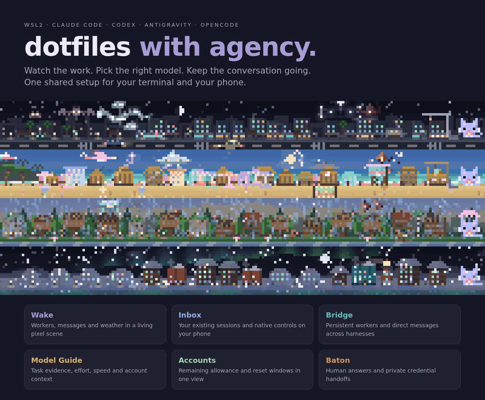</h1>

<p align="center">
<a href="#wake">Watch the work</a> · <a href="#agent-tools">Use the tools</a> · <a href="#why-use-it">What’s included</a> · <a href="#setup">Install</a> · <a href="#packages">Packages</a>
</p>

A shared workspace for **Codex, Claude Code, Antigravity and OpenCode**. Follow your workers in the
terminal, continue their conversations on your phone, and choose a model with the task and available
allowance in view. Shared instructions and skills connect the tools; each CLI or mod can be used on its own.

```sh
git clone https://github.com/vTuanpham/dotfiles-with-agency ~/dotfiles-with-agency && cd ~/dotfiles-with-agency
./install.sh            # preview only: nothing changes
./install.sh --apply    # then apply the steps it listed
```

[Setup, restore details and checks](docs/setup.md) · WSL2 Ubuntu is the tested platform.

## Why use it

<details>
<summary>The toolkit at a glance</summary>

| Tool | What it does |
| --- | --- |
| **[codex-wake](codex-wake/README.md)** | Background task and subagent results resume the idle Codex conversation. `codex-wake monitor` watches a condition and reports matching events. |
| **[Wake](claude/README.md#wake-mod-live)**, a Claude Code mod | A pixel town above the prompt that is the session's live state: eight places, weather and time, a building that rises with each turn, and a crew of real workers that arrive, message each other, react and leave, each in its own way. Plus per-harness quota, effort inferred from what each model supports, and hover cards on everything. |
| **[Agent Bridge](agent-bridge/README.md)** | Delegate persistent jobs across harnesses, or send native peer messages directly to existing Codex, Claude, agy and OpenCode sessions. Jobs can be watched and steered, survive a root change (`handoff`), and archive when finished. It notices when a runtime silently swaps a worker's model. |
| **[Agent Baton](agent-baton/README.md)** | The agent asks; you answer from a Windows toast or your phone. For passwords, 2FA and API keys the value goes straight into the field or env file and **never reaches the agent or its transcript**. |
| **[Agent Inbox](agent-inbox/README.md)** | Your existing Codex, Claude Code and OpenCode conversations, plus saved ACP sessions, on your phone: chat, images, tool steps, supported native questions and `/` commands, over Tailscale. |
| **[Model Guide](agent-models/README.md)** | Combines native model access, account constraints and task evidence across harnesses so the agent can choose a model and effort for the actual job. Measurements retain their source, effort, cost, time and execution setup. |
| **[Portlink](portlink/README.md)** | `portlink open 3000` gives a private, expiring HTTPS link and QR to a local app, build folder or file, for your phone. |
| **[agent-resources](agent-resources/README.md)** | Kernel-lock admission for heavy commands, so five agents do not run five test suites at once. Released automatically when the process exits. |
| **[agent-accounts](agent-accounts/README.md)** | Cached, address-free quota and freshness across Codex, Claude Code and Antigravity accounts, with remaining allowance rounded down. |
| **[agent-lab](agent-lab/README.md)** | Persistent experiment folders outside your repos, with creator and run provenance and guarded cleanup after retirement. |
| **[agent-session](agent-session/README.md)** | One answer to "which conversation is calling?", correct even when Claude Code is started inside a Codex terminal. |
| **[Feedback loop](agents/feedback/README.md)** | Agents file a ticket when a tool gives them trouble, with harness version and session ID attached. Tickets are worked to a root cause and closed, never deleted. |

</details>

## Wake

**[Wake](claude/README.md#wake-mod-live)** puts the session, its workers and account quota above the
Claude Code prompt. Workers move with their activity; messages cross the scene; time and weather change its atmosphere.

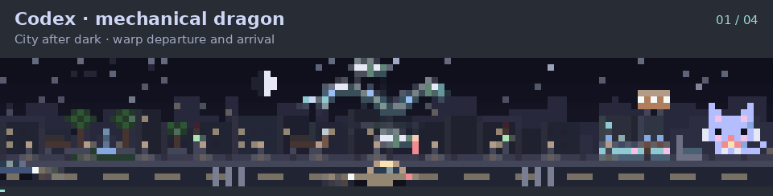

- **Four families, eight habitats.** Codex machines, Claude creatures, AGY constellations and OpenCode
  paper craft each take a different form in every place. A dragon coils above the city, a crab walks the
  quay, a scorpion lights the desert sky, and lanterns drift behind the mountains.
- **Messages you can follow.** Workers slow down, aim and send a packet, song, star or ember. The flight
  leaves a fading trace where it passed; the same exchange lights the peer lane and root graph below.
- **Crew that reacts.** When a message lands the receiver lights up and the sender pulses, each harness in its
  own way, and a gadget pops out of the root's head to catch a message: a dish, radar whiskers, an ear
  trumpet or rabbit-ear antennae, depending on which of four characters you chose (`/wake mochi`).
- **Entrances, pauses and departures.** Dragons warp, saucers beam in, boats sail and paper unfolds.
  Companions enter and leave with their leader. Waiting crews slow down or settle onto a perch.
- **Readable rows.** Quota is coloured per harness, effort reflects each model's
  supported levels, and every item (effort, time, memory, stall reason) has a hover card.
- **Eight places** that follow time, weather and session state: success, failure, waiting and sleeping all
  change the scene, with fireworks, storms, shooting stars, lanterns and rainbows for the milestones.

### The whole crew, by day and night

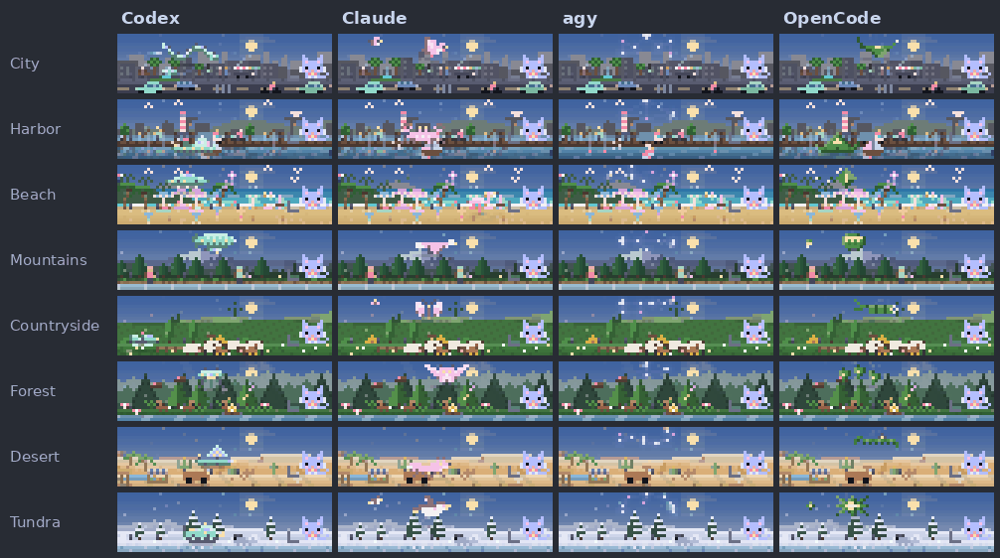

### Messages and their receivers

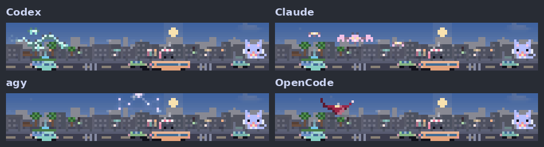

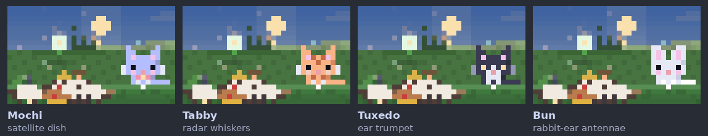

Workers message one another and Mochi in a loop. Each family throws its own projectile and catches messages in its own
way. A message to another family turns into the receiver's own projectile at the top of its arc, and messages between
workers of the same family fly as two braided strands.

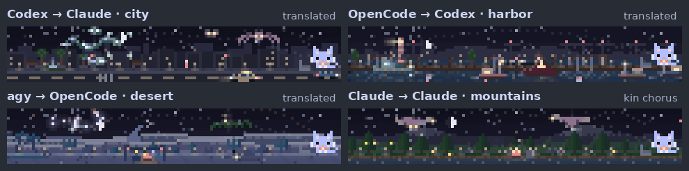

### Arrive, work, leave

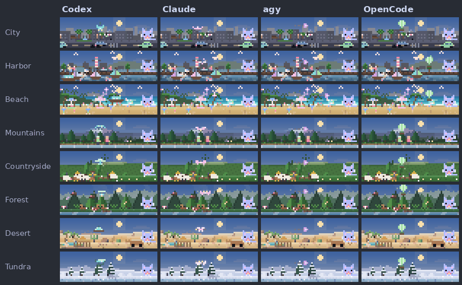

When a turn is interrupted, each family breaks apart differently:

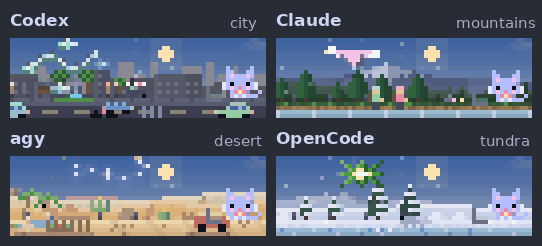

### A day in eight places

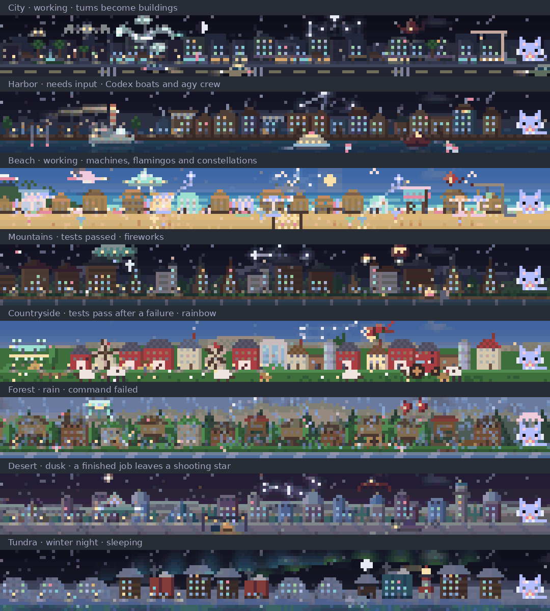

Time and weather are accelerated; the crews use Wake's animation clock.

### Read the scene

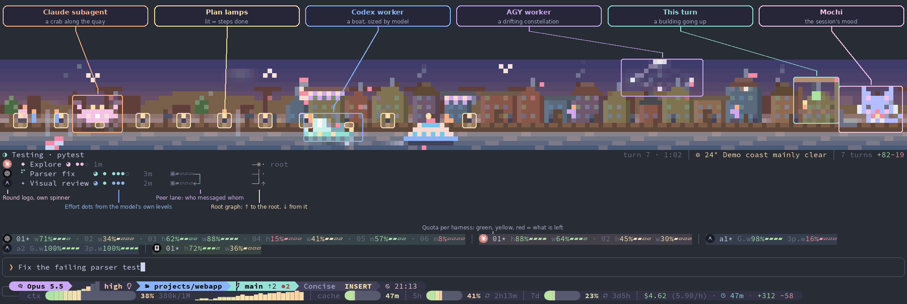

[Crew and quota legend](claude/README.md#crew-and-quota-rows) · [Weather and session state](claude/README.md#landscapes-and-session-state)

## Codex tasks that wake you

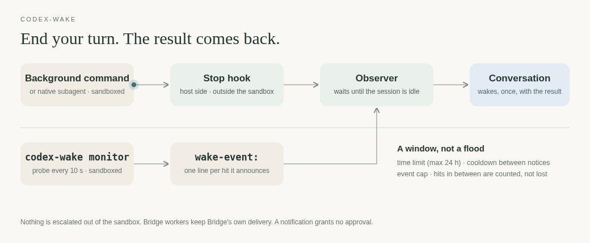

**[codex-wake](codex-wake/README.md)** uses host lifecycle hooks to observe background commands and
subagents. When work finishes and the conversation is idle, it delivers the result with the exit status
and a private log path. Commands keep their original sandbox.

```sh
# launch anything in a background terminal, end your turn, and the result arrives
# or watch a condition for a while: a file, a service, a count
codex-wake monitor --every 10s --ttl 30m --cooldown 5m --max-events 5 -- test -f build/ready
```

The monitor runs a probe on an interval and reports matching events through the same hook.
`--distinct` reports changes to the probe's output.
[Options, limits and live checks](codex-wake/README.md#monitoring-a-condition-for-a-while).

## Agent tools

### Your sessions on your phone


Open an existing conversation, read its work and send a reply from your phone. Inbox connects through
Tailscale and uses each harness's supported controls; it does not create a separate chat history.
[Pair a phone and connect a harness](agent-inbox/README.md#connect-a-harness).

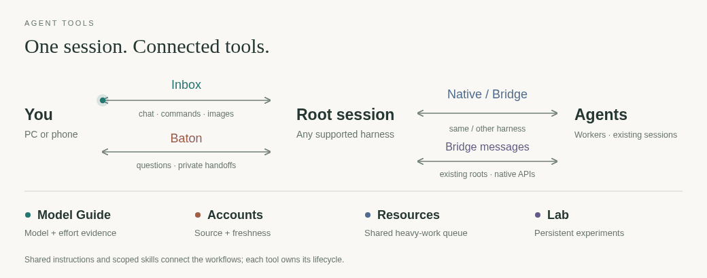

### Delegate work and message other sessions

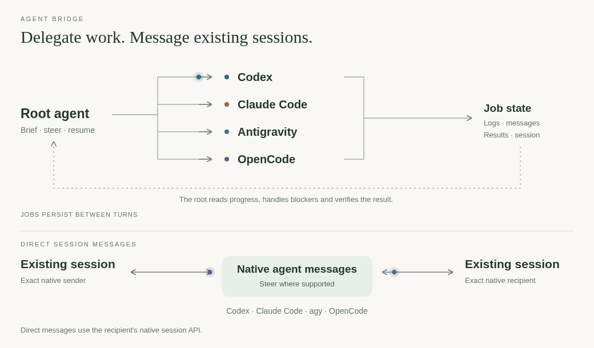

Hand a job to the model that is best for it, watch it, steer it, and let workers message each other.
[Agent Bridge](agent-bridge/README.md) · [Model selection](agent-models/README.md).

Already running in another session? `agent-bridge message` sends a peer message through its native
agent API. Ask for a review, share a finding or coordinate a shared resource without starting another
worker. [Direct messages, discovery and setup](agent-bridge/README.md#direct-session-messages).

### Model selection that shows its work

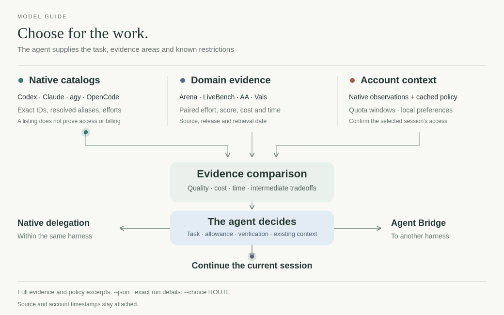

```sh
model-guide suggest --task "fix a flaky failing test"
model-guide benchmarks --domain performance --query sol --brief
```

`suggest` gathers relevant model and effort observations across harnesses. Its optional context
contains facts the caller already knows about the job, permitted routes, accounts and current
session. The agent weighs those facts against the observations; a benchmark leader can be a poor
fit for the available allowance or workflow. `suggest --help` describes the context format.
[Native controls, domain evidence and account context](agent-models/README.md).
An explicit model choice stays intact, including its provider, variant and effort.

[Account observations](agent-accounts/README.md) supply remaining allowance, reset windows and freshness.
The model with the highest benchmark score is one candidate, not an automatic choice.

### Questions on your PC or phone

Use [Baton](agent-baton/README.md) when an agent needs an answer or a private credential handoff.
Secrets go to the target field or environment file without appearing in the agent's transcript.

Phone pushes and session-isolated replies. [Setup](agent-baton/README.md#phone-alerts-and-remote-handoff)
· [Questions and private handoffs](agent-baton/README.md#unanswered-questions).

### Local previews, anywhere


[Portlink](portlink/README.md): private, expiring links to an app, build folder or file.

### Make room for heavy commands

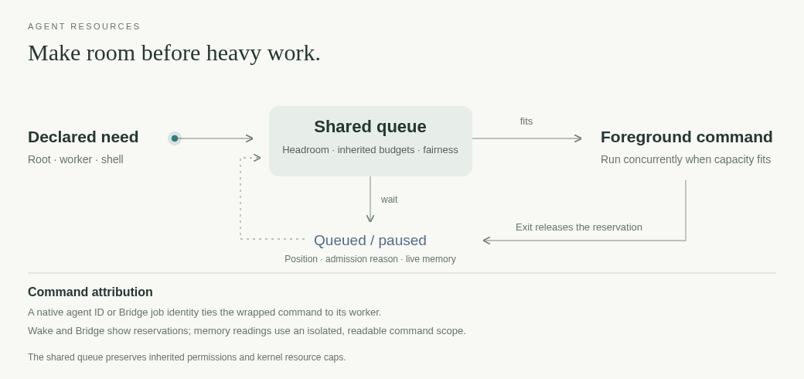

`agent-resources list` shows why a request is waiting and which request is ahead.
Commands run together when capacity permits. [agent-resources](agent-resources/README.md).

Behind the scenes: [account observations](agent-accounts/README.md), [persistent labs](agent-lab/README.md)
and [session identity](agent-session/README.md).

## Built-in guardrails

<details>
<summary>Installation, publication and parallel work</summary>

- **Safe to publish.** `tests/check_public.py` runs as a pre-commit and commit-message hook. It scans for
  credentials, personal identifiers and private project names, and reports where and why, never the
  matching text. Private terms live outside the repository.
- **Safe to install.** `./install.sh` is a dry run by default and never overwrites a file that differs.
  Hook and plugin entries merge into your live files and leave a private backup.
- **Safe to run in parallel.** Resource admission, session-scoped Baton requests and per-owner Bridge locks
  keep several agents from stepping on each other or answering each other's questions.
- **Self-improving.** Agents are told to leave [feedback](agents/feedback/README.md) when a tool misleads
  them, with reporter metadata for tracing. Suggestions are treated as hypotheses; the fix goes to the
  root cause.

</details>

## Setup

[Restore, the manual steps, how files flow, what starts on its own and the checks](docs/setup.md).
Credentials and machine-local state stay outside Git; [handling and publication rules](AGENTS.md).

## Packages

One folder per package, each with its own README. [Every package, and the ordinary dotfiles](docs/packages.md):
[claude](claude/README.md) · [codex](codex/README.md) · [codex-wake](codex-wake/README.md) ·
[agent-bridge](agent-bridge/README.md) · [agent-baton](agent-baton/README.md) · [agent-inbox](agent-inbox/README.md) ·
[agent-models](agent-models/README.md) · [portlink](portlink/README.md) · [shell](shell/README.md) ·
[nvim](nvim/README.md) and more.

## License

Original files: [MIT](LICENSE). Third-party parts keep their own licenses; see [Setup](docs/setup.md#license).
