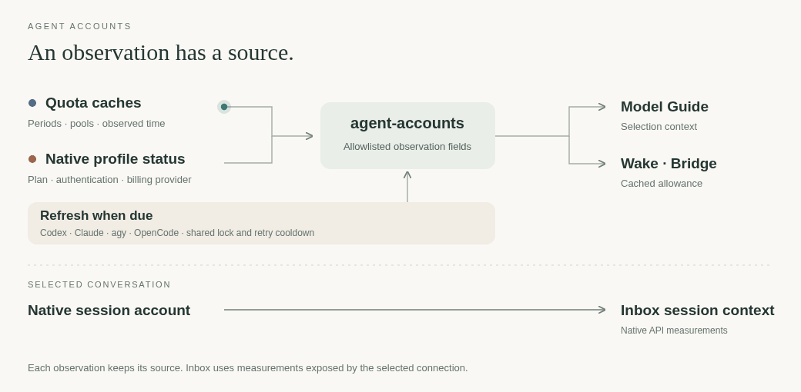

# agent-accounts

[← Packages](../README.md#packages) · **uv tool** · account observations



Read account inventory without scanning jobs, messages or peer history.
The JSON contract carries account aliases, provider, windows, observation time
and freshness. Native window durations, resets, pool IDs and reported exact model
membership stay separate. Missing bindings/limits mean unknown, not unlimited.
Observations become stale after ten minutes or an elapsed reset. Addresses are omitted.

```sh
uv tool install --editable ./agent-accounts
agent-accounts snapshot
agent-accounts refresh --account a1   # explicit agy allowance refresh
agent-accounts refresh --backend claude # explicit cswap allowance refresh
agent-accounts refresh --backend opencode # existing native service, current directory
agent-accounts refresh --backend all --if-stale # refresh due sources for account displays
```

Snapshot reads local Codex data through `codex-auth list --skip-api --json`,
`~/.agy-accounts/*/quota.json`, and the last explicit Claude refresh under
`${XDG_STATE_HOME:-$HOME/.local/state}/agent-accounts/claude.json`.
Codex uses the versioned JSON v1 contract: source snapshot update time, refresh
status, actual `window_minutes` and Unix reset times. No plan label creates a
5-hour, weekly or monthly window. An opaque account-key hash preserves stable
local identity across ephemeral row numbers; it does not bind an existing session.
The current codex-auth projection does not expose metered bucket IDs or exact
model membership, so those fields stay unknown. Missing timestamps stay unknown;
old cached percentages never describe a window after its reset.
An API refresh failure is recorded separately from any still-valid cached windows.
Claude refresh calls `cswap list --json`; it can query usage and renew credentials.
Snapshots remain offline. Account displays explicitly request a due refresh in
the background, publish the cache immediately, and update again when it finishes.
Concurrent displays share a lock and source cooldowns; a failed provider or AGY
account does not block other sources. The cache keeps only numbered allowance
fields, excludes addresses and aliases, and expires freshness after ten minutes.
Claude's percentages are used allowance; this boundary converts them to remaining,
rounds down and never treats unavailable, elapsed or missing windows as free quota.
At a cached window's reset, its label and reset time remain but
`remaining_percent` becomes `null`: Wake displays `h?` beside any still-valid
weekly reading. The account becomes stale; old percentages never describe the
new window. The next due refresh obtains the current windows.
The active mark records the account at the last refresh; it is not session identity.
Native account selection stays in [cswap](../claude/README.md#accounts).
Named Claude scopes remain dynamic. The current cswap projection exposes a display
name but drops raw scope ID/kind/model IDs; the shared view does not invent exact
membership or duration for those scopes. Missing five-hour windows stay absent.

AGY refresh reads the native read-only `/usage` structured command payload,
preserving bucket IDs, period enums, fractions and ISO reset times. Rounded text
rows are not decoded. Distinct buckets remain distinct even when readings match.
Legacy text caches remain labelled as such until refreshed, with binding unknown.
An empty structured response cannot establish account availability, so it leaves
the previous cache intact and reports a refresh failure.
The observed native `/model` payload exposes the selected ID/effort, but neither
it nor `/usage` supplies exact pool members. Native pool names do not establish
model access. Bridge refuses automatic account rotation when that binding is
unavailable; it never guesses a pool or cost tier from a model name.

OpenCode refresh uses the documented native `GET /api/experimental/usage/limits`
for the current directory, with a 30-second deadline and 1 MiB response limit.
It leaves credentials with the service. The private `agent-accounts/opencode.json`
cache stores a workspace hash, directory and normalized quota windows, excluding
workspace names, URLs and raw provider fields. Snapshot reads that cache only in
the matching directory and expires freshness after ten minutes; elapsed windows
keep their identity/reset with unknown remaining allowance. Null/signed-out,
unavailable, missing and malformed data never become available quota. Failed
refreshes preserve the previous cache, whose original age remains visible.

Go meters describe used workspace allowance, not independent remaining quotas for
each model or the free tier. Console windows retain the native spend-budget scope
(member/shared, set/per-model and covered provider/model IDs); missing per-model
counters remain unknown. Spend caps are not credits, and Go billing is separate.
No account or session is switched. The native service observation cannot establish
that a running standalone session has the same workspace or entitlement. Source
contracts and versioned schema: [model guide sources](../agent-models/src/agent_models/guide/sources.md).

Model-guide searches also use the provider context helper: quota observations
plus Claude's native auth-status plan/billing profile, with identity fields
removed. These hints are read dynamically, not stored in the benchmark snapshot
or hardcoded as model entitlements. Existing sessions can retain a different
account from the current profile.
Model-guide's separate `policy --backend BACKEND` command caches complete official
policy text on a slower cadence. The selecting agent interprets plan changes,
shared limits, paid-credit distinctions and opportunity cost together with these
native observations; percentages cannot predict task consumption.

Codex refresh uses `codex-auth list --api --json`; its native registry owns the
usage cache. Failed refreshes leave valid cached windows visible. Last-attempt
status is recorded separately and attached by stable account-key hash, so a failed
account never adds a warning to another account or follows a reused row number.

Refresh uses the selected account's existing file login and validates the result
before atomically replacing its private quota cache. It never signs in, switches
accounts or creates an auth store. Refresh without --account queries all existing
signed-in agy accounts. Claude refresh reads the full managed inventory and does
not accept `--account`. Errors do not include provider stderr or credential data.

Inbox continues to read allowance from the selected native daemon; a machine-wide
cache must not substitute for a conversation's account.

Checks: `uv run pytest` and `uv run ruff check src tests`.
