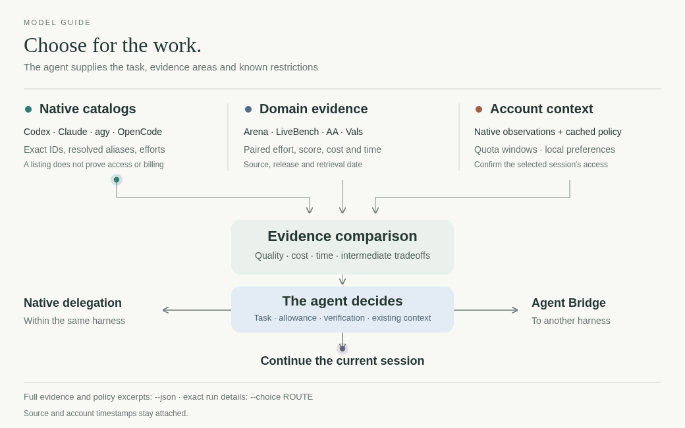

# agent-models

[← Packages](../README.md#packages) · **uv tool** · shared model references



Native routes, task evidence and published allowances have one owner, independent
of worker orchestration. The selecting agent weighs the actual task and current
session against these observations; no model-role table or score chooses for it.
Arena, Artificial Analysis, LiveBench and Vals measure different outcomes.


[Dated measurements and methodology](src/agent_models/guide/models.md#effort-and-model-strength).

```sh
uv tool install --with-editable ./agent-accounts --editable ./agent-models
model-guide read models
model-guide models --backend codex --json  # native IDs/efforts + generated coverage
model-guide read subscriptions     # only for allowance/retention decisions
model-guide policy --backend claude # official policy text; auto-fetch missing/due 7-day cache
model-guide check                  # reference files only; no provider processes
model-guide check --live           # explicitly query native inventories
model-guide refresh --prepare      # public data + cost curves; no model worker
model-guide benchmarks --backend claude --domain design --query sonnet --limit 5 --brief
model-guide benchmarks --backend codex --domain backend --limit 3 --brief
model-guide suggest --task "UI refactor"
model-guide suggest --task "Records disappear when writers run together"
model-guide suggest --task "Fix failing tests" --context /tmp/decision.json
model-guide suggest --backend codex --task "Fix code" --domain coding --query luna --json
model-guide suggest --help          # optional context JSON schema and exact admission rules
model-guide preferences list         # private notes, including expiry and attribution
model-guide usage                    # attributable local Bridge turn outcomes
model-guide benchmarks --domain performance --query sol --brief
model-guide benchmarks --domain debugging --query sonnet --brief
model-guide read maintenance
```

The daily `agent-models-reference.timer` checks drift and conditionally polls due
sources (36h, with backoff); changed observations update the cache and generate a
numeric guide proposal when none is waiting.
No agent or Bridge is launched. Subscription facts and source contracts are
source-reviewed on demand with `refresh --record --yes`. Cached numeric observations
are usable without a human stamp per decision; no proposal applies automatically.
Pending guide review freezes that proposal while due/backoff-aware observation
polling continues; queries use the current cache, and apply reviews its saved snapshot.
Official subscription policy has a separate seven-day cache, refreshed when due
by `policy` or routine polling. It stores complete source text, digest and check
dates; a failed check retains last-good text and reports the error. `suggest`
retrieves relevant sections, tables and their qualifications from that cache;
selection never waits for a policy fetch. Missing/stale sources link to `policy`.
Text shows one policy status/drill-down per harness. Retrieved sections and their
conditions stay complete in JSON; ordinary comparisons omit unrelated policy prose.
The selecting agent interprets current conditions, exceptions and quota
opportunity cost; no plan-to-window/model/multiplier table is encoded in selection.
State belongs to `$AGENT_MODELS_HOME` or
`${XDG_STATE_HOME:-~/.local/state}/agent-models`; documents and review hashes live
in `src/agent_models/guide/`. Reference edits remain uncommitted.

`usage` summarizes unambiguously paired Bridge turns by the model, account and
effort requested at turn start. It does not infer the actual model or account,
task quality, quota consumption or token cost. Native effort observations are
shown separately when available. Claude token totals cover the main agent's
per-turn reported input and output, excluding cached input and helper calls;
`token_turns` shows how many turns supplied those numbers. Older and overlapping turns that
cannot be paired are counted as skipped. The source logs and conversation
content stay local.

Benchmark search returns bounded source evidence: release/retrieval dates, domain
scores, effort, available cost/time and automatically read local account hints.
Missing measurements stay unknown. The full local snapshot supports rechecks
without loading an entire leaderboard into the agent's context.

`--task` keeps the full description and combines lexical cues with local semantic
suggestions to prioritize evidence. The suggestions are not filters: task queries
retain evidence from all areas in `--json` and `--choice`, so an incomplete inference
does not hide it. With no cached model, lexical matches work without downloading;
otherwise the first semantic-only use downloads a pinned 22 MiB public embedding
model and tokenizer. Task text never leaves the machine. Use repeated `--domain`
flags to restrict evidence when needed. A task is optional for general lookup.
Without `--backend`, native
inventories are discovered independently across all four harnesses; partial
failures remain visible. No provider model is prompted. Native catalogs are read
fresh, evidence is indexed once per query, and account state is captured once.

Use optional ephemeral `--context PATH|-` JSON for actual caller restrictions and
considerations (full schema in `suggest --help`). `allowed_backends` is closed when
supplied. `allowed_routes` restricts only its listed backends using exact native
routes/aliases; omitted backends have unknown entitlement. `allowed_efforts`
intersects native controls. Account, task, session and priority descriptions stay
context for the selecting agent. Plan names, urgency, scarcity and free billing
never imply access, adequacy or a winner. Context is not persisted.

`model-guide preferences add --source user|agent --note '...'` records a private
selection note; `--backend`, `--model`, `--account`, `--task`, `--reason` and
`--expires YYYY-MM-DD` add scope and context. `preferences remove ID` deletes
one. Unexpired notes appear in `suggest` with user-attributed notes first. Source
is caller attribution, not an identity check. Notes inform judgment; they do not
prove entitlement, restrict routes, or replace explicit task context.

Every admitted route and supported measured effort remains in `--json`, including
unmeasured models and missing speed. The default comparison shows up to 12 models:
the current session, distinct access/billing pools and source-scoped examples of
quality, cost, time and intermediate tradeoffs. Equivalent underlying models share
a comparison while their execution/billing routes stay distinct. Each example
shows selected measured efforts with their paired score, cost and time, preserving
missing prices and source/run scope. Inclusion reasons describe the evidence or
route shown; they do not recommend a winner. Native effort choices and account
windows are shown separately; a window is attached to a route only when its
native observation names that exact model. Different sample counts stay visible. Speed
points keep effort, tokens/s, first-token latency and workload together; the brief includes
a measured middle native effort when available as well as speed extremes. These are
source measurements, not predictions of this job's cost or duration.
Inspect `--choice ROUTE` for other settings and run scope;
use flexible `--query` discovery or `--limit N --offset K` to page the comparison
(JSON pages native inventory order). There is no winner shortlist, tier/newness bonus, combined
score or cheapest-first policy. Native aliases share a resolved model, while
OpenCode provider/free variants remain separate execution routes.

`--choice EXACT_NATIVE_ROUTE --effort LEVEL` preserves explicit choices and reports
problems without substitution. Measurements at other efforts are shown separately,
not treated as results at the selected effort. Optional `--max-usd`/`--max-seconds` constrain each
published source observation; unknowns cannot establish a bound or prove actual
route spend/latency. Reviewed model links transfer model evidence, not provider
reliability, speed, price or entitlement. Account overrides are supported only by
agy's native listing; other backends use their selected native session.

Source/version, dates, samples, intervals, harness, configuration and workload
remain available in JSON. Task duration, response/first-token latency and tokens/s
are distinct. Legacy cached AA speed and model release dates are recovered in
memory without fetch or proposal approval; reported zero remains validity-unknown.
Native descriptions/modalities are facts or claims, not task-quality scores.
Vision perception and browser/OSWorld outcomes remain separate.

Queries show **quality leaders** and **cost-efficient choices** as separate bounded
views, so a small limit does not hide cheap workers. Frontiers are recalculated
after native/query filtering, within the same source, release and metric; table
runs with different harnesses stay separate. API cost is not subscription quota.
`--domain backend` uses coding and terminal evidence and names the gaps in database,
security and service-architecture coverage. Writing retains its text-preference
scope. `--brief` keeps source dates, confidence intervals, run settings and account
freshness in compact text; omit it for JSON and the complete returned fields.

`--backend` matches exact model identities from Codex, Claude, Antigravity or
OpenCode; `--query` narrows by native ID/alias. Claude aliases resolve through
initialization with no prompt, session history, hooks or MCP launches. Codex and
Claude publish per-model effort metadata; OpenCode's native API CLI supplies
enabled models and variants for the current directory. agy's text listing leaves
efforts unknown: verify its selected native controls. `--account` scopes cached
account observations; only agy supports an explicit native inventory account.
Otherwise the listing uses the current native profile. No account is switched.
Native responses are captured through a temporary regular-file handle: OpenCode
can truncate large JSON when it exits while pipe output is still pending. The
file closes after each read; catalogs and account observations are not tracked.

Use a model/effort exposed by the actual native worker tool. The selecting agent
weighs task fit, verification, context/setup, allowance and risk; benchmark values
cannot establish these task-specific costs. Bridge owns cross-harness execution.

Listings describe native CLI inventory, not entitlement or the models selectable
by a particular native subagent tool. Account caches are separate observations;
the current session's native controls remain authoritative. The reviewed OpenCode
privacy allowlist lives in inventory.py and is also consumed by Bridge.

OpenCode's listing marks named free variants; `unverified` means the catalog does
not establish billing for other IDs. It does not mean paid, unavailable or out
of included quota. Preserve the requested provider/model/variant, and verify a
chat request in the matching native CLI/session. A service catalog or API error
does not establish the result for a standalone CLI session.

Shared orchestration does not own provider protocols or account lifecycle.

Checks: `uv run pytest`, `uv run ruff check src tests` and `uv run ty check`.
The ordinary suite is offline.
