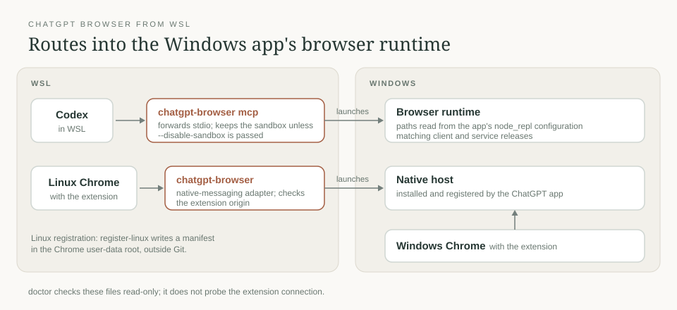

# chrome

[← Packages](../README.md#packages) · **Live adapter** · **Manual extension registration**

| Layer | Owner | Setup |
| --- | --- | --- |
| Extension download | Chrome Web Store | System registration below; Chrome downloads it on normal startup |
| ChatGPT native host + browser runtime | Windows ChatGPT app | Settings → Computer Use → Chrome |
| WSL stdio transport | [`chatgpt-browser`](.local/bin/chatgpt-browser) | `./install.sh --apply links` |
| Browser operation rules | App's unchanged bundled Chrome skill | Link its folder into local Codex skills |

## Extensions for Linux Chrome

Chrome extensions for every profile. Google Chrome on Linux installs an extension for all profiles and all users when a
`<extension-id>.json` with the Web Store update URL sits in a system extensions dir.
A per-user `External Extensions` folder is not honored on Linux (tested on the Dev channel).
Users can still disable or remove these; Chrome does not reinstall a removed one.

| File | Extension |
| --- | --- |
| `fcoeoabgfenejglbffodgkkbkcdhcgfn.json` | Claude in Chrome (Anthropic) |
| `hehggadaopoacecdllhhajmbjkdcmajg.json` | ChatGPT (OpenAI) |

Install (needs sudo; both documented system paths, so any channel finds them):

```sh
sudo install -d -m 755 /usr/share/google-chrome/extensions /opt/google/chrome/extensions
sudo install -m 644 -t /usr/share/google-chrome/extensions ~/dotfiles-with-agency/chrome/extensions/*.json
sudo install -m 644 -t /opt/google/chrome/extensions ~/dotfiles-with-agency/chrome/extensions/*.json
```

Start or restart **normal Chrome in the profile you use** afterwards. The JSONs
register downloads; they are not copies of the installed extensions. A headless
test browser with `--disable-extensions` does not install or activate them.
Verify both extension cards and their enabled switches at `chrome://extensions/`.
Authentication and account consent remain per profile.

Claude Code's Chrome integration is [documented as unsupported in WSL](https://code.claude.com/docs/en/chrome).
The Claude extension can still install and sign in; that alone does not establish
a Claude Code connection. Use the connection preflight below before relying on it.

## Claude connection preflight

Loaded Chrome tools or a connected MCP server do not establish a live browser
connection. Call `tabs_context_mcp` with `createIfEmpty: false` first. A successful
"No MCP tab groups found" response leaves the browser unchanged; it does not
verify page control. Verify an actual page read when the task needs one.

If it reports "Browser extension is not connected", check that normal Chrome is
open in the intended profile with the extension enabled. Chrome being closed is
one documented cause; also check that the extension and CLI use the same Claude
account and organization (`/status`). Run `/chrome` → Reconnect extension and
retry the context call. A headless browser with extensions disabled does not
satisfy these conditions. See [Anthropic's connection troubleshooting](https://code.claude.com/docs/en/chrome#common-error-messages).

For an isolated local app check, use that project's maintained headless test
workflow when available; it verifies the app, not this extension connection.

## ChatGPT from WSL: gap and local compatibility patch

Start diagnosis with `chatgpt-browser doctor` (read-only). It checks Windows
native-host/runtime files, Codex's MCP launcher, and configured Linux profiles.
Use `doctor <user-data-dir>` to require a particular Linux registration; unused
profiles are informational. The script uses UV to select Python with TOML support,
so it does not depend on the system Python version.

Local checks do not prove a live extension connection. Finish with browser
discovery through the harness's native Chrome tools; no separate browser client
or alternative control route is needed.

Discovery alone does not prove page control either. If discovery works but
navigation or page reads fail, use the bundled skill's Chrome troubleshooting
guide. Compare the loaded plugin version with the plugin shipped in the installed
app: updating the app can leave the active plugin behind. Refresh it through
the app's Computer Use setup; do not replace files in the generated plugin cache.

An existing browser JavaScript session can retain the old client after a plugin
update. Release its diagnostic tabs, reset that JavaScript session, and bootstrap
with the current plugin's `scripts/browser-client.mjs`. Verify navigation and a
page read again; reconnecting the browser handle alone may retain the mismatch.

Each MCP startup reads executable and browser-service paths from the Windows
app's current `node_repl` configuration. Client and service plugin metadata must
name the same release. No native-host sidecar configuration is required or
rewritten. Linux native-messaging startup separately validates its registered
host and extension origin; it does not depend on MCP or skill configuration.
Missing files or mismatched plugin releases require the app's Computer Use setup.
`doctor` and `paths` are read-only.

**The desktop app's WSL browser integration is the product gap.** The inspected
Windows app reports browser availability as `reason=wsl-disabled` when running
the agent in WSL. This is an installed-build observation, not a published promise
of support. Its Chrome side chat uses a separate availability path.

**Missing native-host registration is a local installation fault.** The extension
reported `Specified native messaging host not found`; Chrome requires a separate
host manifest and, on Windows, a registry entry. Repair that through the app's
Computer Use setup first. The local repair used the app's unchanged bundled host
and installer. No extension source or signed app archive was patched.

The adapter connects WSL Codex to that existing Windows runtime. It discovers
the registered host, reads the app-managed runtime paths, and forwards browser
stdio. Linux Chrome can use the same host through its own native-host manifest.
It needs no Chrome remote-debugging setting or DevTools server.

**Transport is not native WSL integration.** The Windows runtime rejects native
WSL sandbox metadata (`sandboxCwd` is a Linux file URI). An explicitly authorized
`chatgpt-browser mcp --disable-sandbox` uses the runtime's documented exception
for its Windows JavaScript kernel. Keep it scoped to this browser launcher;
Codex's own sandbox and mandatory approval review remain enabled. A standalone
client without an attached execution reviewer fails strict approval checks.
Neither launching Chrome nor opening a URL proves extension control works.

| Route | Transport |
| --- | --- |
| WSL Codex → Windows runtime | `chatgpt-browser mcp --disable-sandbox` after explicit authorization |
| Windows Chrome → runtime | App-installed native host |
| Linux Chrome → runtime | `chatgpt-browser` native-messaging adapter |



Requirements: WSL interoperability, Python 3.11+, `wslpath`, Windows PowerShell,
and the Windows ChatGPT app with its Chrome plugin and native host installed.
Account/workspace access and site permissions still apply. This is a local
compatibility path, not official WSL desktop integration or a policy override.

1. Link the adapter: `./install.sh --apply links`.
2. Configure `node_repl` in local WSL `~/.codex/config.toml` with an **absolute
   Python 3.11+ interpreter** as `command` and the absolute adapter path followed
   by `mcp` as `args`. WSL-to-Windows use also needs `--disable-sandbox` in those
   args after explicit authorization. The default keeps the kernel sandbox;
   the adapter never silently enables this exception. Keep machine paths and
   authorization outside this public repository. Reload MCP configuration or
   start a fresh chat to expose its `js` tool.

3. For Linux Chrome, register its existing **user-data root**, not `Default` or
   `Profile 1` beneath it. For example, on the Dev channel:

   ```sh
   chatgpt-browser register-linux ~/.config/google-chrome-unstable
   ```

   Use `~/.config/google-chrome` for Stable, or the actual custom root. The command
   preserves a different existing host and keeps the app's allowed extension
   origins. The generated manifest stays outside Git.
4. `chatgpt-browser paths` reports the official skill and browser-client URL.
   Link that skill's folder to `~/.codex/skills/control-chrome` locally. Browser
   actions use the official `js` tool and unchanged skill. During bootstrap,
   import the returned `client_url`: this runtime uses Windows paths, not WSL
   `/mnt/...` paths.

   The client is under the **plugin root's** `scripts/`, not under the skill
   directory. Use the reported `client_url`; a missing `scripts/` beside a linked
   skill is not evidence that the installed runtime is missing. If MCP startup
   failed, fix and restart `node_repl` before looking for its `js` tool.

The adapter checks the app's configured executables exist, checks client/service
release agreement, and refuses extra runtime flags from app configuration. When
the app omits skills from its plugin cache, `paths` selects its unchanged bundled
marketplace skill only when its plugin release matches the installed client.
Only the explicit launcher option disables the kernel sandbox; it does not
change approval policies or bring over the computer-control service.
Check the selected browser instance when both Windows and Linux Chrome are open.

## Visible agent tabs

Claude Code sessions first use the [connection preflight](#claude-connection-preflight).

Retain control while useful to ongoing work or a pending handoff; otherwise
release this task's resources, preserving user content and needed results.

Select the browser instance for the intended OS/host and profile, and use its
existing window. Reuse a suitable tab or open a new tab in that window. Create
a window only if no suitable window is open or the user requests one.
`browser.user.openTabs()` discovers user tabs; an empty `browser.tabs.list()`
does not mean the user has no browser window open.

Name the browser session and group its controlled tabs under a task label such
as **🤖 Agent · Research**, using a consistent warm color. Include claimed user
tabs: claiming an existing tab does not group it automatically. Use the selected
browser's documented management capability, with IDs returned by that capability.
Reuse groups created by this task, one per window; respect pinned/shared-group
restrictions and leave unrelated tabs in place.

Before borrowing a tab, record its original grouping and group appearance.
On release, close disposable agent-created tabs, remove retained tabs from the
agent group, and restore borrowed tabs' original grouping. Recreate an original
group if moving its last tab removed it. Preserve useful results and pending
handoffs with the browser's native deliverable/handoff controls; a pending
handoff group can use **Review · Research**. Restore grouping only while the tab
remains in this task's group, respecting later user changes.

Use documented task-scoped release controls when available. Where the harness
owns release at turn end, finalize tab preservation and grouping before that
cleanup. Ungrouping alone does not confirm that control or its pointer was
released. Keep shared MCP servers and other tasks' browser sessions running.
The installed Chrome client documents `markDeliverable()` and `markHandoff()`
for turn-end preservation; these do not themselves end browser control.

### Idle reminder

Codex's native hooks run the linked
[`chatgpt-browser-idle.py`](.local/libexec/chatgpt-browser-idle.py): one short
lifecycle reminder on initial tool use, then one cleanup check after five idle
minutes. Install with `./install.sh --apply links hooks`, then review the new
hooks in Codex with `/hooks`. The official browser runtime and skill stay unchanged.

Already-running app-server threads can need a config reload. Native clients can
use `config/batchWrite` with `{"edits": [], "reloadUserConfig": true}` to reload
without editing config or restarting the shared daemon. Verify discovery/trust
through `hooks/list`, then check an actual tool invocation; discovery alone does
not prove the running thread has adopted the hook. See the
[app-server API](https://learn.chatgpt.com/docs/app-server).

`PreToolUse` records activity; background `PostToolUse` waits without holding up
the tool. New calls cancel older timers, and pending calls suppress idle notices.
`Stop`, `Interrupt` and `SessionEnd` cancel the corresponding state. State uses
session **and turn** IDs, so another conversation or turn cannot reset its timer.
The private SQLite file under `${XDG_STATE_HOME:-$HOME/.local/state}/chatgpt-browser/`
stores only call identities and timestamps; completed turns are removed, with
abandoned records pruned after a day on subsequent hook activity.

The reminder observes the browser-capable `node_repl` JavaScript tool, including
non-browser JavaScript; it does not inspect Chrome or infer that tabs are held.
It only asks the agent to review its own resources. It never closes tabs, stops
MCP servers or changes tool output. Delivery waits for Codex's next safe model
step; an inactive turn cannot be woken. Other harnesses retain the documented
lifecycle rules without this Codex hook. See the
[official hook contract](https://learn.chatgpt.com/docs/hooks#run-hooks-in-the-background).

Test the hook with `python3 -B tests/test_browser_idle.py` from the repository root.

Remove this reminder by removing its handlers from the five hook events in
local `~/.codex/hooks.json`; keep unrelated handlers. Its local state directory
can then be removed. The state directory and hook approvals are never synced.

To remove the compatibility path, remove the local `node_repl` MCP entry and only
the Linux native-host manifest generated above. The app owns the Windows host;
manage that through its UI. Extension registration and extension account login
are separate from the adapter.

Sources: [OpenAI browser extension setup](https://learn.chatgpt.com/docs/chrome-extension),
[Codex MCP configuration](https://learn.chatgpt.com/docs/extend/mcp?surface=cli),
[Chrome external extension registration](https://developer.chrome.com/docs/extensions/how-to/distribute/install-extensions),
[Chrome native messaging](https://developer.chrome.com/docs/extensions/develop/concepts/native-messaging).
