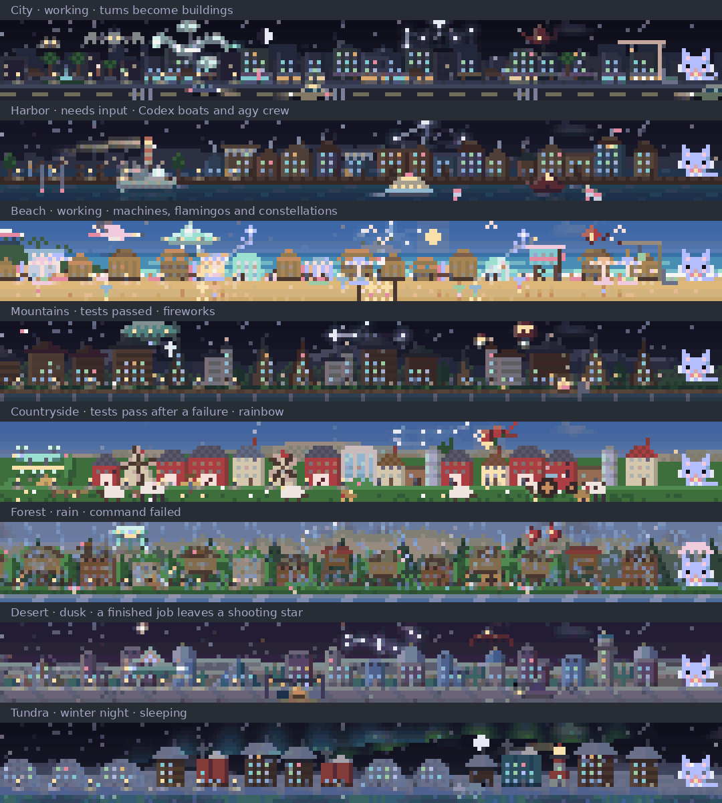
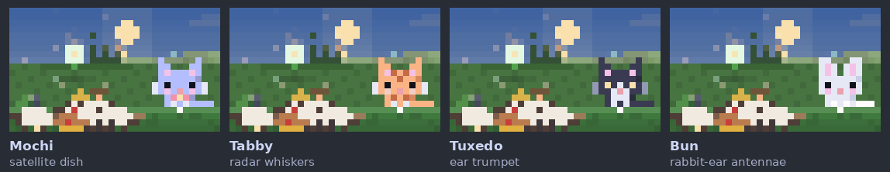
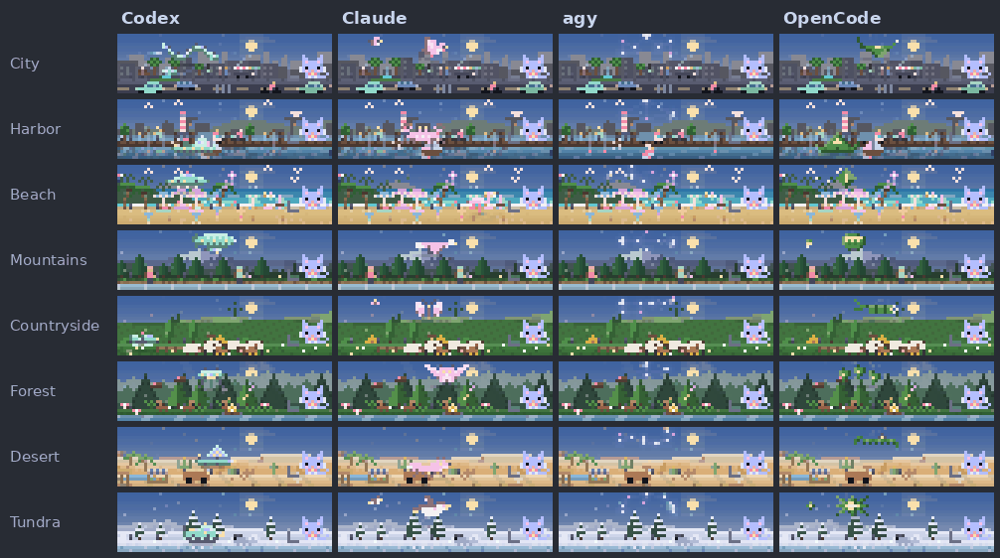
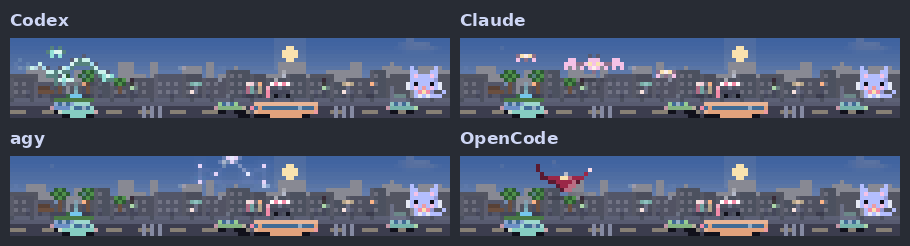
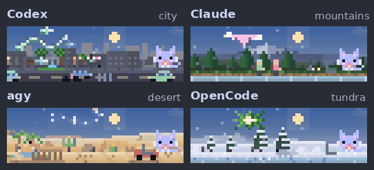
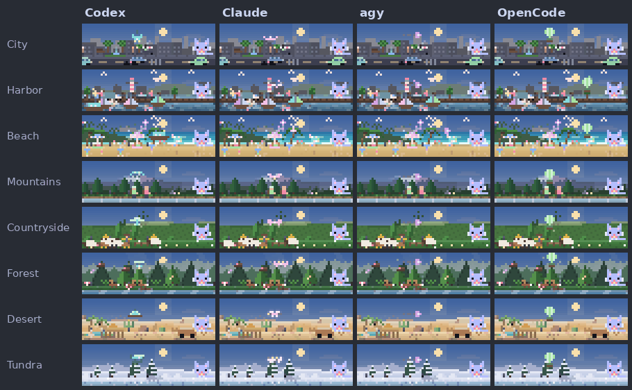

# claude

[← Packages](../README.md#packages) · **Snapshot + live** · [Accounts](#accounts) · [Hooks](#hooks) · [Remote questions](#remote-questions-and-notifications) · [Wake mod](#wake-mod-live)

Claude Code configuration under `~/.claude`. Each part has its own kind:

| Part | Kind | Restore |
| --- | --- | --- |
| `settings.json`, status lines (`statusline-starship.sh` runs `statusline.py`; `subagent_statusline.py` draws the subagent rows) | Snapshot: holds this machine's paths | `install.sh --apply snapshots` copies what is missing on a new machine |
| `CLAUDE.md` (`~/.claude/CLAUDE.md` links here; it imports the shared `~/.config/agents/AGENTS.md`), Bridge/Baton and the [pstack skills](../agents/README.md#engineering-skills) | Live link | `install.sh --apply links` |
| Hook and plugin entries | Merged into the live `settings.json` | `install.sh --apply hooks` |
| [Root stop safety net](.claude/hooks/README.md) | Script is a live link; entries merge into settings | `install.sh --apply links`, then `install.sh --apply hooks` |
| [Wake mod](#wake-mod-live) | Live link; reloads as its files change | `install.sh --apply links` |

The status line's second row shows context use, then **how long this session's prompt cache stays warm** (`cache ▰▰▱ 47m`,
`cache cold` once it has lapsed), then the rate limits and cost. A turn refreshes the cache, so the countdown restarts at each
response. `statusline.py` reads the last main-conversation response in the transcript and takes the lifetime (5 minutes or 1 hour)
from how that cache was written, else from `promptCacheTtl` or `CLAUDE_CODE_PROMPT_CACHE_TTL`, else an hour.

## Accounts

[claude-swap](https://github.com/realiti4/claude-swap) (`cswap`) owns native Claude
account selection, like `codex-auth` does for Codex. The installer adds the reviewed
CLI release through uv; account stores and settings remain private on each host.

```text
cswap ── explicit allowance refresh ── agent-accounts cache ─┬─ Wake
                                                           └─ Bridge
```

```sh
cswap add                              # save the current login without logging out
cswap list --json                      # inspect managed accounts and usage
cswap switch 2                         # select an authorized account
agent-accounts refresh --backend claude # update the shared allowance view
```

Adding another account: use Claude's normal login flow, then `cswap add` again.
Do not log out first: logout can revoke the saved account's refresh token.
Account numbers are local to cswap; shared observations omit addresses and aliases.
Wake uses each numbered account's cached allowance. If its windows have expired,
run `agent-accounts refresh --backend claude` to fetch that account's usage through
cswap; the next local Wake poll picks it up. A session reading is not substituted
for a numbered account without verified identity.

Switch between sessions; verify Claude's `/status` and reconnect Remote Control
if it drops. Automatic rotation is not enabled. Before considering parallel
account launches, check the upstream [session-token report](https://github.com/realiti4/claude-swap/issues/515):
in 0.29.0, a preset `CLAUDE_CONFIG_DIR` bypasses the same-account protection.
Do not use `cswap run` from a redirected profile or run one account through both
the default login and a session profile. `--require-session` refuses the ordinary
same-account fast path but does not repair that preset-directory case.

On Linux/WSL, account data lives in `${XDG_DATA_HOME:-$HOME/.local/share}/claude-swap`.
Its `.enc` files are Base64 with private file permissions, not encrypted vaults;
exports are plaintext credentials. Keep this directory and exports outside Git.
Upgrade deliberately with `uv tool install claude-swap==VERSION` after checking
the release; nothing installs an autoswitch service or modifies the Claude launcher.

## Cache and thread reuse

Within included subscription usage, Claude Code's main conversation defaults to
a one-hour prompt cache; subagents and most other requests default to five
minutes. Usage credits, API keys and cloud-provider requests default to five
minutes for both. Explicit settings can change these defaults; see the
[official prompt-cache guide](https://code.claude.com/docs/en/prompt-caching#which-ttl-each-request-gets).
Reuse context when relevant, and start fresh when unrelated history outweighs
the benefit; a warm cache does not make an oversized conversation free.

## Hooks

The settings snapshot selects `/bin/bash` for Claude's Bash tool through
[`CLAUDE_CODE_SHELL`](https://code.claude.com/docs/en/env-vars). Interactive Zsh
keeps its native parsing; agent compatibility does not change `.zshenv` options.

`settings.json` defines Bash checks and a browser guard, shared with Codex (`codex/.codex/hooks.json`):

| Matcher | Command | What it does |
| --- | --- | --- |
| `Bash` | `rtk.py` | Uses RTK's native rewrite outside auto/plan modes; [classifier-reviewed commands stay intact](.claude/hooks/README.md#rtk-and-auto-review) |
| `Bash` | `agent-process-guard.py` | Parses shell commands and rejects full-command process matches that include the invoking ancestry; [behavior](../shell/README.md#agent-process-matching) |
| `Bash` | `agent-baton guard` | Denies the agent `agent-baton back` and `cancel`, and, while a `pass` request is out, any shell route to the browser or screen |
| MCP tools whose names contain browser, chrome, computer, playwright, puppeteer, cua or devtools | `agent-baton guard` | Blocks those tools while a `pass` request is out, and never lets them open a password manager |

`install.sh --apply links hooks` links the scripts and adds any entries your live `~/.claude/settings.json` lacks, keeps everything
else in it (replacing the former managed RTK Bash entry), and leaves a private recovery copy under
`${XDG_STATE_HOME:-$HOME/.local/state}/backups/dotfiles-with-agency/<timestamp>/`. The guard fails closed only while a `pass` request
is out. Claude also loads the `ponytail` plugin (`enabledPlugins` and `extraKnownMarketplaces` in
`settings.json`; see "Plugin: ponytail" in the top-level README), which ships hooks of its own.

## Remote questions and notifications

The [root Stop hook](.claude/hooks/README.md) reminds the root once to arm a
Bridge watch or acknowledge unread work before ending a turn. It allows user
questions and fails open on errors. Disable with `AGENT_BRIDGE_STOP_GUARD=0 claude`.

The settings snapshot enables `remoteControlAtStartup`, `inputNeededNotifEnabled`
and `agentPushNotifEnabled`. Remote Control provides the native phone/browser
answer path; the Claude mobile app must use the same account and allow notifications.
Push delivery also depends on an active Remote Control connection and presence:
Claude suppresses pushes while the connected terminal is focused or being used.
[Remote Control and mobile alerts](https://code.claude.com/docs/en/remote-control#mobile-push-notifications).

`AskUserQuestion` and permission prompts stay pending until answered. The
`dialogExpiry` setting applies to other forwarded dialogs, so changing it does
not implement a question timeout. No automatic-dismissal hook is installed.
Agent Inbox does not intercept these questions. See its [Claude limitations](../agent-inbox/README.md#connect-a-harness).
[Documented limits](https://code.claude.com/docs/en/remote-control#limitations),
[shared question policy](../agent-baton/README.md#native-questions-and-hooks).

## Wake mod (live)

`.claude/mods/wake` is a Claude Code mod: the animated diorama above the prompt
(the session as a town in the real weather where you are), the crew row
(subagents, Bridge jobs), recaps, the plan in the spinner and the Bridge job tidy scan.
Retired Bridge jobs leave the crew row. The tidy scan counts only retired jobs past their
purge date, excludes dirty worktrees, and asks the root to run `agent-bridge purge`;
it never recommends deleting jobs still within retention. `agent-bridge restore` reactivates
a retained job with its original session.
Unlike the snapshot files, the mod is used in place and reloads as its files change.
It is Claude-only; [Agent Bridge](../agent-bridge/README.md) and
[Agent Baton](../agent-baton/README.md) work in every harness.

### Landscapes and session state



*Actual renderer output, animating. Each scene is an example state, time and weather. `/wake tour` visits them all; `/wake scene <name>` pins one.*

| What changes | What Wake draws |
| --- | --- |
| Turns and tool calls | Structures and coloured windows; the current turn is under construction |
| Bridge workers and Claude subagents | Crew sprites by harness and model class, plus compact crew rows |
| Job stops making progress | Amber stale marker |
| Tests pass / command fails / Bridge job finishes | Fireworks / storm / shooting star, in the local style (harbor and beach fireworks mirror in the water; the desert storm is sand and the tundra's a blizzard; a tundra job lights the aurora); the shooting star is a streak with a tapering tail and a few embers hanging behind it |
| Every plan step done / tests pass right after a failed turn | Paper lanterns drift up from the ground / a rainbow draws itself over the scene (the biggest milestone of a turn gets the scene: failure, then a finished plan, then the rainbow, then fireworks) |
| Plan steps / session mood | Lit lamps / Mochi working, waiting, happy, sad or asleep |
| A message reaches a worker, or leaves one | The sender pulses as the comet launches and the receiver lights up as it lands, each harness in its own way: Codex a widening ripple, Claude twinkling stars, agy rising sparks, OpenCode a burst of confetti |
| A message reaches Mochi (or she sends one) | A gadget pops out of her head, one per character: a satellite dish with signal arcs (Mochi), whiskers turned radar with rings sliding in (Tabby), an ear trumpet with notes drifting into it (Tuxedo), rabbit-ear antennae with TV static between them (Bun) |
| Place, time and weather | Landscape, sun, moon phase and local weather |

### Characters, arrivals and exits



*Mochi, Tabby, Tuxedo and Bun (`/wake mochi <name>`), each catching a message with its own gadget. Actual renderer output.*

### The crew at work

Every worker is a small, slim design whose **structure itself moves**: a travelling wave, a wingbeat, billowing fabric,
a breathing paper shade, not a fixed sprite with a blinking pixel. Each family has one idea, drawn differently in every
place, and four classes that grow the same design (1 Haiku/Luna, 2 Sonnet/Terra, 3 Opus/Sol, 4 Fable/Astra; unknown models
are class 2) by length, with escorts flying beside the biggest.



*Every family in every place at class 4, working. Actual renderer output.*

| Family | The idea | By place |
| --- | --- | --- |
| Codex | Mint clockwork with a glass eye and gear | Dragon, whale, jellyfish, airship, bee, spider, scarab and narwhal |
| Claude | Living winged creatures in the family's pink | Pigeon, pelican, flamingo, eagle, butterfly, owl, dragonfly and puffin |
| agy | Constellations with a moving pulse of light | Crown, sail, starfish, condor, plough, tree, scorpion and aurora arch |
| OpenCode | Paper and cloth with a warm window | Crane, carp streamer, kite, sky lantern, balloon, lantern string, flying carpet and paper star |

Each design declares how it faces and turns (`hooks/landscapes/design.ts`): a dragon coils into a spiral and uncurls the
other way, a headed craft or bird banks, and a symmetric design never turns. Workers may pass through one another in the open
sky (only Mochi and her laptop are hard boundaries), and they hide a little scenery when they must.

### Messages

When a worker has a message for Mochi it does not fly backward to say it. It **brakes to a hover** with momentum, its wings
still beating, **turns to face her**, and only then **sends**: the call, the packet along the trail and the pulse on
the sender. Mochi (or Tabby, Tuxedo, Bun) catches it with a gadget, the worker **turns back** to the course it is about to fly and
gathers speed again. It works the same way for a Bridge worker and for a native Claude subagent (the engine's
`session.send` reports every SendMessage), in both directions.



*Brake, turn, send, catch, turn back, resume, per family. Actual renderer output.*

### Interrupts

A worker whose turn is cut off by the root (a native subagent's aborted turn, or a Bridge job's interrupted turn) does not
take a bow: a bolt strikes it, it flashes white, shudders and falls dissolving, shedding what it is made of.



*Struck down, in each family's own debris. Actual renderer output.*

### Arrivals and exits

A worker is a visitor with a life of its own. It **arrives** when its job starts, or when a reply wakes it, and it **leaves the
moment it is done**: a Bridge job parked waiting for the root leaves then, not only when it is finally retired; a native
subagent leaves when it goes idle. Each craft does both in its own way, and each landscape changes how:



*Every family in every place: arriving (2.4 s), working, then leaving (3.2 s). Actual renderer output.*

Codex machines hyperdrive, sail, roar off or lift away in their place's way (the city dragon charges, shakes, goes white and
warps off in a streak of light), Claude's creatures soar, skim, loop or fade, agy's light gathers and ends as a ring, ripples,
glints or an aurora ribbon, and OpenCode's lanterns rise and burn out into petals, spores or a flurry. An arrival is the same
thing played backwards. A subagent is kept in the scene only while it leaves, and nothing else (the crew rows, the counts,
`/wake`) counts it; a worker already running when Wake starts does not replay its arrival. Each style is one small function in
`hooks/exit-styles.ts`; `hooks/exits.ts` runs them, so a new style or place is a single entry.

### Crew and quota rows

Bridge crew has one line per job: title, harness and model class, state, effort,
time since the last event, memory against its cap, and peer links from the last
15 minutes. Dead quota accounts fold into one range. Color distinguishes
families and states; short marks replace repeated model and status words. All
rows use the same columns, so each worker keeps its own harness and class. Narrow
layouts shrink titles and omit the same lower-priority columns for every row;
`/wake legend` explains the marks. A stalled or blocked job carries its reason
when there is room. Finished jobs remain until Bridge's `result` or `ack`.
A finished peer also stays visible while a recent exchange connects it to another
shown worker, so both endpoints remain in the inline graph for those 15 minutes.

The compact list follows Claude Code's subagent presentation: one recognizable
marker and name, a brief state and small counters, with color providing emphasis
and longer explanations kept out of the list. The row uses vendor logos where the
terminal supports inline images, with text alternatives otherwise. Model-maker
logos appear in hover details only when the model ID identifies the maker.
The [Claude Code documentation](https://code.claude.com/docs/en/sub-agents)
describes its subagent workflow and status access.

A filling circle beside the harness mark shows the class (see [the crew at work](#the-crew-at-work) for the designs), and
Claude's workers (its subagents and Claude Bridge jobs) are in the family's pink; the code is in `hooks/landscapes/`
(`craft.ts`, `creatures.ts`, `agy.ts`, `lantern.ts`) and [`CREW.md`](.claude/mods/wake/hooks/landscapes/CREW.md) is the standard
every new design is held to.

**Crew life is data for one particle engine** (`hooks/landscapes/particles.ts`; the guide and recipes are in
[`hooks/landscapes/CREW.md`](.claude/mods/wake/hooks/landscapes/CREW.md)). Every effect is an emitter or a light
described in a table, stateless, so any frame draws alone and a trail is exactly the sprite's own path:

- **They touch their place.** The dragon trails data packets and a booster jet; the whale throws spray, the spider sheds silk
  glints and the scarab kicks up dust; feathers shake loose off wings and paper scraps trail the crane.
- **Dusk and night change the crew, only where the design motivates it.** The dragon's head glows, planes show navigation
  lights, lanterns glow from the flame and light the ground under them, agy's light lights its halo, owls have eyeshine.
- **Wind is real.** Gusts cross the whole sky faster the harder it blows, each place blows its own things about (dust, spray,
  sand, snow, petals, leaves), and trails and smoke lean downwind.
- **Motion follows what the worker really does.** A worker's pace is high just after an event and eases off over two
  minutes; waiting, paused and stalled workers are calm and a running one is never idle. A busy worker roams wider, its
  gait quickens and its wings beat faster; a change of pace never jumps the sprite, and a worker that talks to the root
  hovers for it. An event hops the sprite and flares its effects.
- **Lanes, not slots.** The whole width of the sky is shared out among the flyers by size, so one worker roams the sky end to
  end and four a quarter each.
- **Hand-made moments.** Arrivals, exits and message reactions are handcrafted pixels, not particles: the sender pulses as
  the comet launches and the receiver as it lands (Codex a widening ripple, Claude twinkling stars, agy rising sparks, OpenCode
  a burst of colour), and Mochi or another character catches it with a gadget that pops out of their head.

A worker's arrival and exit run from the moment Wake sees it start or stop (Bridge's own times are already seconds old), and
Wake looks at Bridge every five seconds while a worker runs and straight after an `agent-bridge start`, `resume`, `steer`,
`watch` or `result`.
A filling circle beside the harness mark (◔ ◑ ◕ ◉) shows the class, and effort is a
five-bar signal icon (an image where the terminal shows images, ▁▃▄·· as text) for Bridge
jobs and Claude subagents alike. Each row opens with the harness logo and, while the worker
runs, the harness's own spinner (Codex orbits, agy twinkles, OpenCode's lantern flickers); the
working headline's spinner follows the command: a shell spins, tests fill a gauge, edits grow a caret,
reads fill a page, searches circle, agents turn a gem, the web turns a globe; thinking keeps the
landscape's own.
The root has one place in every worker row: a `◉` node on the first row, a
spine down to the last worker tied to it, `─┤`/`─┘` branches, and `↑`/`↓` for the last message
to or from the root (`·` when the worker simply works for it); a packet runs the spine as a
message arrives and a tie fades over 15 minutes. The graph's column hugs the longest row (its
words, metrics and peer lanes) with a small gap, and steps a few cells further out only while a
message is crossing, so the packets have room; the row's leader stays empty except for a few beads
while a message arrives. Every metric opens a card under the pointer: effort says which levels the
model offers, Bridge time reflects its last activity, native Claude time is elapsed since first observed,
and Bridge memory shows scope use/cap. `?` on a worker means its current state is unknown;
when a source is unavailable, hover for its last observed state until a later scan succeeds.
Native `r...` / `⌁...` marks show declared local-command reservations, never agent RAM or a cap; hover
one for its command, queue state and reason. `r?` means the resource scan was unavailable. A stall reason
is shown in full. A SubagentStart hook gives each native child its owner and agent ID and asks it
to export them in Bash calls that invoke `agent-resources`, including through scripts. This is
best effort: unattributed commands have no worker mark. Cards open upward inside
their full row's bounds, including at narrow widths. Peer cards distinguish previews
withheld by Bridge from missing message metadata; withheld text is never reconstructed
from raw logs or replaced with an older message. In the scene a trail of faint embers
joins each worker (native or Bridge) to Mochi: working for the root is a relationship, not a message.
Worker, quota and actionable rows get room before decorative sky or optional
recap details. The scene trims its upper sky from ten rows down to six when
needed, preserving its ground, character, animation and matching hover targets.
Only a band too small for that compact scene drops it. If the terminal still
cannot fit every worker, crew paging keeps them reachable; recap details may
fold into an overflow count. A count never takes the place of a quota row that
would otherwise fit.
Bridge event cursors survive mod reloads with the session's notification state,
so an unanswered event does not create another dismiss row after each edit.
When a job finishes, its "needs you" row shows the first line of prose of its report: a markdown
table, heading marks, bullets and code fences are skipped, and a report that is only a table says so.
A stall mark comes from Bridge's shared
[stall classifier](../agent-bridge/src/agent_bridge/guide/status.md#bounded-waits-and-one-stall-classifier-v12);
known waits have their own reasons. Finished jobs stay as `done` until Bridge's
`result` or explicit `ack` acknowledges their completion.

Bridge jobs and tidy eligibility come from
[`agent-bridge status --json`](../agent-bridge/src/agent_bridge/guide/status.md).
Quota observations come independently from
[`agent-accounts snapshot`](../agent-accounts/README.md).
Wake maps the shared state and stall reason; heavy waits, root pauses and retry
backoff stay normal known states. Colored gutter lanes join connected peers;
← points to the recipient, ─, ━ and ═ represent 1, 2–4 and 5+ messages,
and ┄/┆ show a declared peer or dependency wait. Motion means a message just arrived: when Wake
first sees new messages on a link, one packet per message (up to five, a beat apart) crosses the
lane once from sender to recipient, then the lane rests. History Wake never saw arrive does not
move, nor does a wait. A worker's state mark lights when it acts, then settles. In the scene a
message is a comet in the sender's harness colour whose short tail fades quickly behind it, running an
arc between the two workers' fixed places (never their moving sprites). The trail is drawn
behind the sky's buildings, crew, weather and Mochi, so it takes nothing from them, and a soft
splash marks where it lands. Message links fade gradually and are gone after 15 minutes. The gutter
shrinks with the terminal; where a group cannot fit, the existing ↗/↙ peer marks remain.
Root messages use the root graph at the right edge (above). Arcs connect workers
to Mochi. Hover details show the scrubbed preview and distinguish
Bridge observing worker output from sending a root prompt or steer; neither
proves the recipient read it. The root endpoint is the owner namespace across
session handoffs. The native Claude `statusline.py` still renders
Claude's own session/context/cost input; it has no separate Bridge parser.

Wake shows quota rows for native sessions and Bridge jobs. It reads the local account
snapshot, then requests a bounded refresh and reads it again, and it does this when something
happened rather than on a fast timer: the engine pushes this session's own five-hour and weekly
windows as they move a whole point, and those update the active Claude row at once; a finished
turn, an `agent-bridge` start/resume/steer/compact, and `cswap`, `codex-auth` or `agy-auth`
(which re-read their own backend, since a switched login is not in the cache) each ask for a look,
bursts folded to one every ten seconds. While a Bridge worker runs, a reading older than two
minutes is due instead of ten; a five-minute timer remains only as a safety net. Provider
cooldowns in `agent-accounts` still bound how often anything is asked.
The rows show remaining allowance by reported window, including OpenCode's current
workspace budgets. `h` is five-hour, `w` weekly and `m` monthly when the source
reports those durations; pool and model bindings stay as reported by the provider.
Hover for the window name, remaining allowance, reset time and last update. Refresh
failures appear there; the JSON account snapshot retains source metadata. The
active-account mark describes the current CLI profile, not every running conversation.

`*` marks the active account; `?` means its quota is unknown, and `~` marks a
stale reading or one without a known sample time. Idle accounts of one CLI with the same
numbers fold into a range (`02–06~ m0%`) however long ago each was read, because a window
stays at its numbers until it resets; one stale reading marks the range.

### Use and check

Use the live mod in place:

```sh
ln -s ~/dotfiles-with-agency/claude/.claude/mods ~/.claude/mods
```

`settings.json` loads it in every session through
`"env": { "CLAUDE_CODE_PLUGIN_DIRS": "~/.claude/mods/wake" }`, and an
interactive session reloads it when its files change, so edits here apply live.

`agent-bridge message` uses Claude's existing native peer messaging socket,
independently of Wake. Setup, delivery receipts and limits belong to
`agent-bridge guide messages`; no extra mod or UI input is involved.

- `/wake` summarises; `/wake legend` explains the crew; `/wake tour` plays every landscape for 12 s, a whole day in each; `/wake crew` shows demo workers arriving, working at each class, sending a message, being interrupted and leaving in each landscape by day and night; `/wake scene <city|harbor|beach|mountains|countryside|forest|desert|tundra|auto>`
  pins a landscape to the current place; `/wake place <city|auto>` overrides the
  IP-based location (GeoJS, then ipwho.is; weather from Open-Meteo; all keyless).
- `/wake mochi <mochi|tabby|tuxedo|bun>` chooses who stands in Mochi's place: Mochi (lavender, belled collar),
  Tabby (orange, striped), Tuxedo (black and white, yellow eyes) or Bun (a white rabbit). `/wake mochi` alone
  shows the current one. Each is two hand-drawn frames in `hooks/mochi.ts`, and each has its own gadget for
  catching a message (`hooks/reactions.ts`); adding a character means drawing two frames and giving it a gadget.
- Pins, the place, the chosen character and cached weather live in the mod's store
  (`~/.claude/plugins/store/wake_*.json`), not here.
- Checks, from the mod folder: `claude plugin validate .`, `claude plugin test .`,
  and `npx -y -p typescript tsc -p .` (the engine writes `.claude-plugin/types/`
  on load; it is ignored).
  If every test file reports "did not load" with child exit code 0, check sandbox
  restrictions on the child harness; rerun the same command outside the sandbox
  when authorized. Type checking does not replace the runtime suite.
- For a focused runtime check: `python3 test.py tests/logos.test.ts` (multiple files
  are accepted; no files runs the full suite). It stages a private disposable
  copy containing only those test files, keeps shared helpers, and uses the same
  native `claude plugin test` kit and exit status. The live mod is untouched.
  On hook failures, read the runner's **the engine reported:** block for the
  inner missing implementation; stub every mods API call the hook uses.
  [The test-kit guide](https://code.claude.com/docs/en/plugins/mods/test) documents
  these stubs. Keep wall-clock limits so hung I/O still fails; use focused runs
  and host admission for full suites rather than raising limits with host load.
- `bun dev/showcase.ts`, `bun dev/dock.ts` and `bun dev/crew-life.ts` render the animation frames behind the README GIFs
  ([docs/tools](../docs/tools/README.md) turns them into images).
- `bun dev/crew.ts <codex|agy|claude|opencode>` renders the four sprite classes over every landscape;
  `bun dev/crew-review.ts` renders synthetic before/after rows at three widths.
- The crew, for design review: `bun dev/cast.ts [place|all]` draws the whole cast large; `bun dev/passages.ts <place> [class]`
  shows every family arriving and leaving frame by frame; `bun dev/fx.ts <place> [pace] [wind] [hour]` shows the air effects;
  `bun dev/roam.ts [place]` prints how far each family travels and its largest step per paint; `bun dev/perf.ts` prints
  milliseconds a painted frame (the scene repaints twenty times a second, a 50 ms budget; it runs 1 to 6 ms: compare before and
  after a change).
- Motion and traffic over time, for nested crews: `bun dev/motion.ts [out.png] [width]` renders the
  scene through solo, chain, burst and crowded cases at several moments (patrol, hops, packets);
  `bun dev/rows.ts [width]` prints the inline rows' marks, lanes and root spine per moment as text,
  to confirm motion starts only on real arrivals and stops after.
- Live look without a screenshot: run `claude` in a detached `tmux` pane (no prompt needed), then
  `tmux capture-pane -t PANE -e -p > pane.ans` and `uv run --with pillow python dev/ansi-png.py pane.ans out.png [from] [to]`
  renders the band with its true colours and half-block pixels.
- Look at a landscape before changing it: `bun dev/preview.ts <landscape>` writes
  a sheet of every day phase, weather, effect and event to `dev/<landscape>.png`.
- Paint scene cards in the same Raster as the animation. The Client captures pointers
  only: independently redrawing an overlapping Client can briefly clear the fullscreen
  scene. Check continuous mouse movement in the configured terminal mode; hook traces
  and the test kit do not verify terminal compositing.
